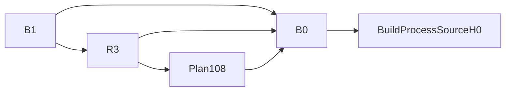

# Source13实际构建、M98与技术准入事实核01

**固定FS事实已核；G3/G4未审未签，正式Rust240 / 本批新认证0不变。** 本件只覆盖已完成的build180-03、正常双库M98、after164/schema3守恒及API136/B0/plan/R3/B1构造，不认证Tax、H46/H47、期末201或全部32项业务验收。

本轮未执行Root helper、Cargo、SQL/HTTP/浏览器、角色或服务动作，未读取活state、当前SQL负控或Tax活动文件。只读指定fixed artifacts及其原件链，审件只写本专属目录；旧183/189/193及Source12失败/partial/ignored标签不改。

## 实际构建与进程

- actual-build binding raw `15e088cf...`与source416/digest`5e467b67...`、H0195一致。Root inventory/copy `cb1702be...`与mirror实际构建 `e3fb002f...`是两个不同原件；**RootCompilationExecuted=false**，不把一次mirror编译算成两次。
- Root、copy后mirror与Cargo输入各523项逐路径/hash一致，完整compiled scope323项一致；记录的Root/mirror输入稳定且未继承DB测试opt-in。
- mirror四命令各exit0：fmt `-- --check`；生产lib Clippy `--lib --no-deps -- -D warnings`；test `--all-targets`；build `--bin poms-api-rust --example r4ghi_summary_producer08`。原stdout/stderr均按pin核。实际测试汇总535 passed / 0 failed / 54 ignored；ignored不称实际数据库验收。旧180-02 all-target Clippy的166 lib-test错误/101失败仍保留，不称本轮测试target Clippy通过。
- 实际API binary raw `2d9ed8f711818b83b1cff440b72265bcacf9ff2f31f409d2d7d5a9aabd346e13`；Common/summary producer raw `45efe528cb5045b8f9f46293144990fbd8641025f3e805f3847c15a5d6bb0f24`均实际回读。
- start182回执`d284d452...`、process record `0b5817a0...`、readiness原stdout `2a475fb8...`匹配：PID99398、startTime2781292、startedAt2026-11-08T16:07:33.503Z、port31441、readiness200及同一binary2d9。启动wrapper exit0不等于API进程已退出；本件未探测当前liveness。

## 双库正常M98及数据边界

正常bundle `dff57fbd...`与完整receipt `fad604ce...`一致。逐库真实argv均为批准Node24 binary + runner136 + `--database <唯一该库> --execute`；runner29e、Nodebc17、G2b155、SQL90b、TSdaf等pin一致。intent、execution、raw stdout相互关联，实际`migratorMethod=up`、唯一options `{migrations:[M98名]}`，pending仅M98、applied仅M98、executedAfter98，两个数据库各exit0。不宣称跨数据库原子事务。

独立重算5份sealed snapshots、1390个表文件引用、1112份唯一row文件，并核每行raw SHA：

| 范围 | 独立核实结果 |
| --- | --- |
| retained→migrationBefore | 二者是同一个批准的007492/106c pin；不描述为另一次fresh-before数据库采样 |
| before→after164/3e7451 | 两库各138业务表及原97条migration行的raw/xmin不变；其它catalog/OID/owner/ACL/roles/constraints/triggers不变 |
| 允许function变化 | `jghi_assignment_participant_guard()`同OID：Native26561、Rust27648；definition frame/属性不变，只有body与批准SQL完全相同 |
| 允许canonical记录 | 每库唯一新migration行key98；Native xmin4693、Rust4695，名字精确为M98；原行身份不改 |
| 允许sequence变化 | 同OID `poms_migrations_id_seq`仅97→98，一次推进；其它sequence不变 |
| after→schema3 fresh000001/778a | 全139表raw/xmin/metadata及captured objects一致 |
| M97原baseline与derived | R3/verification仍指原f402；derived5163的138业务表**文件指针**及objects仍与原f402相同，仅canonical metadata及poms_migrations指针取after |

实际after164 receipt raw `90202b49...`及schema verification `1480d9f7...`与重算证据一致。`retainedSnapshotEquivalent=false` / `schemaAdvanceOnly=true`保持真实含义；不能把M98后的整体库说成与M97全等，也不能把derived称业务baseline重置。没有读取当前live state.baseline；这里封的是R3/verification/derived及冻结producer的原字节链。M98属于canonical schema advancement，后续不得进入owned fixture cleanup。

## B0 → plan/R3 → B1无回写环

- B0 `11530fcd...`绑定实际build、process/readiness、source416/5e467/H0195及M98/139表；没有R3或B1 pin。
- final plan `Source13-final-plan108.json` raw `060b52d132b3cfb4384085f77f9c1637d60e50ad9c5510a249bab60dd2143f8c`已核；consumer candidate只指B0，输入registry/derivedComparison为null，不引用未来R3/B1。
- R3 `000004-consumer-admission108-registry.json` raw `23cc54f891fb5200a1bad30083f75805e27a1d046096705381034ff32493971c`是schema3；consumer和plan完全一致，candidateReceipt永久指原B0，不指B1；prior registry及birthSource历史10/11/12链保持。
- B1 `4c4ff2dc...`另指B0与R3；B0原有公共字段与B1相同，B1没有反填B0/R3。B0/B1均actorBindingsFinal=false、formalG3Certified=false、G3/G4=false；技术admitted不是业务交付认证。

## 当前停止线

现R3固定只有7个fixture admission，确无`/fixtures/sharedSourceFollowup58`。Root报告Tax203因此在HTTP前停止，涉及真实旧出生来源的工具协议问题；本件未读该活动状态/原Tax失败包，不追加JSON、改birth epoch或推断新协议。原G2/H0/R3/B0/B1保留。

正在/随后进行的M98五安全负控、Tax、H46、H47、自然期末和完整32项，仍各待真实固定证据及独立审核。日历跨过香港零点不表示来源资格或期间201已通过，历史自动选包也未获批准。当前不关闭Issue、不放行main/部署/切流、不签G3/G4。
